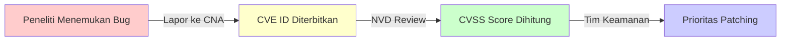

# 🔎 Pertemuan 11: CVE & CVSS — Manajemen Kerentanan

## Daftar Isi
1. [Pendahuluan](#1-pendahuluan)
2. [CVE (Common Vulnerabilities and Exposures)](#2-cve-common-vulnerabilities-and-exposures)
3. [CVSS (Common Vulnerability Scoring System)](#3-cvss-common-vulnerability-scoring-system)
4. [Hubungan CVE dan CVSS](#4-hubungan-cve-dan-cvss)
5. [Hands-On: Mencari dan Menganalisis CVE](#5-hands-on-mencari-dan-menganalisis-cve)
6. [Hands-On: Menghitung CVSS Score Secara Manual](#6-hands-on-menghitung-cvss-score-secara-manual)
7. [Ringkasan dan Praktik Terbaik](#7-ringkasan-dan-praktik-terbaik)
8. [Latihan Mandiri](#8-latihan-mandiri)

---

## 1. Pendahuluan

Dalam dunia keamanan siber, ditemukan ribuan kerentanan baru setiap tahunnya. Untuk mengelolanya secara efektif, para profesional keamanan memerlukan dua hal: **identifikasi unik** untuk setiap kerentanan dan **standar pengukuran tingkat keparahannya**. Di sinilah peran **CVE** dan **CVSS**.

---

## 2. CVE (Common Vulnerabilities and Exposures)

### 2.1 Apa itu CVE?
**CVE adalah program internasional yang bertujuan untuk mengidentifikasi, mendefinisikan, dan mengkatalogkan kerentanan keamanan siber yang diungkapkan ke publik.**

CVE **bukan** sistem penilaian atau basis data yang lengkap — CVE adalah **"daftar"** yang berisi entri-entri dengan format standar.

### 2.2 Format CVE ID

```
CVE-TAHUN-NOMOR_UNIK
Contoh: CVE-2021-44228 (Log4Shell)
         CVE-2017-0144  (EternalBlue / WannaCry)
```

### 2.3 Komponen Minimal Sebuah Entri CVE

| Komponen | Keterangan |
| :------- | :--------- |
| **ID** | Pengidentifikasi unik (`CVE-YYYY-NNNNN`) |
| **Deskripsi** | Penjelasan naratif kerentanan dalam bahasa Inggris |
| **Referensi Publik** | Tautan sumber yang terkait |

> **Poin Penting:** CVE **tidak menyediakan skor keparahan**. Tujuannya hanya menyediakan **pengidentifikasi umum**.

### 2.4 Siapa yang Mengelola CVE?

Program CVE dikelola oleh **MITRE Corporation** dengan pendanaan dari US Department of Homeland Security. Kontennya diperkaya oleh mitra global yang disebut **CVE Numbering Authorities (CNAs)**.

---

## 3. CVSS (Common Vulnerability Scoring System)

### 3.1 Apa itu CVSS?

**CVSS adalah standar terbuka untuk menilai keparahan kerentanan keamanan komputer.** Standar ini dikelola oleh **FIRST (Forum of Incident Response and Security Teams)**, bukan MITRE.

Jika CVE memberikan "nama" pada kerentanan, maka **CVSS adalah "angka" yang menggambarkan seberapa parah kerentanan tersebut**.

### 3.2 Komponen Metrik CVSS v4.0

**1. Base Metric Group (Wajib)**

Menggambarkan karakteristik intrinsik kerentanan yang tidak berubah seiring waktu.

| Metrik | Opsi |
| :----- | :--- |
| **Attack Vector (AV)** | Network, Adjacent, Local, Physical |
| **Attack Complexity (AC)** | Low, High |
| **Privileges Required (PR)** | None, Low, High |
| **User Interaction (UI)** | None, Passive, Active |
| **Confidentiality Impact (C)** | None, Low, High |
| **Integrity Impact (I)** | None, Low, High |
| **Availability Impact (A)** | None, Low, High |

**2. Threat Metric Group (Opsional)**

Mengukur ancaman berdasarkan ketersediaan exploit di dunia nyata.
- **Exploit Maturity**: Attacked, Proof-of-Concept, Unreported

**3. Environmental Metric Group (Opsional)**

Disesuaikan oleh organisasi untuk mencerminkan dampak di lingkungan mereka sendiri.

### 3.3 Tabel Severity Rating

| Kategori | Rentang Skor (CVSS v3/4) |
| :------- | :----------------------- |
| **Critical** | 9.0 – 10.0 |
| **High** | 7.0 – 8.9 |
| **Medium** | 4.0 – 6.9 |
| **Low** | 0.1 – 3.9 |

---

## 4. Hubungan CVE dan CVSS



**Alur Kerja Standar:**
1. Peneliti menemukan bug → mendapat **CVE ID**
2. NVD (National Vulnerability Database / NIST) mereview dan menghitung **CVSS Score**
3. Tim keamanan perusahaan melihat NVD → membaca deskripsi CVE + skor CVSS → memutuskan prioritas penambalan

### 4.1 Contoh Konkret: Log4Shell

| Aspek | Detail |
| :---- | :----- |
| **CVE ID** | `CVE-2021-44228` |
| **Deskripsi** | Apache Log4j2 JNDI features remote code execution via crafted log messages |
| **CVSS Score** | **10.0 (Critical)** |
| **Vector** | `CVSS:3.1/AV:N/AC:L/PR:N/UI:N/S:C/C:H/I:H/A:H` |
| **Artinya** | Bisa dieksploitasi dari jaringan, tanpa autentikasi, tanpa interaksi user, dampak penuh pada C/I/A |

### 4.2 Tabel Perbandingan CVE vs CVSS

| Fitur | **CVE** | **CVSS** |
| :---- | :------ | :------- |
| **Kepanjangan** | Common Vulnerabilities and Exposures | Common Vulnerability Scoring System |
| **Fungsi Utama** | Memberi ID/nama pada kerentanan | Menilai tingkat keparahan (skor) |
| **Output** | ID (`CVE-2024-1234`) + Deskripsi | Angka (0.0–10.0) + Kategori |
| **Pengelola** | MITRE (dengan CNAs) | FIRST |
| **Apakah menyediakan skor?** | **Tidak** | **Ya** |

---

## 5. Hands-On: Mencari dan Menganalisis CVE

### 5.1 Setup Lab — Kali Linux Container

```bash
docker run -it --rm --name kali-cve kalilinux/kali-rolling /bin/bash
apt update && apt install -y curl jq
```

### 5.2 Query NVD API untuk CVE Tertentu

```bash
# Cari informasi CVE-2021-44228 (Log4Shell)
curl -s "https://services.nvd.nist.gov/rest/json/cves/2.0?cveId=CVE-2021-44228" | \
  python3 -c "
import sys, json
data = json.load(sys.stdin)
cve = data['vulnerabilities'][0]['cve']
print('ID:', cve['id'])
print('Deskripsi:', cve['descriptions'][0]['value'][:200], '...')
print('CVSS Score:', cve['metrics']['cvssMetricV31'][0]['cvssData']['baseScore'])
print('Severity:', cve['metrics']['cvssMetricV31'][0]['cvssData']['baseSeverity'])
"
```

### 5.3 Scanning Kerentanan dengan Nmap NSE

```bash
# Scan target untuk kerentanan umum
nmap --script vuln -sV 172.20.0.10

# Scan spesifik untuk MS17-010 (EternalBlue)
nmap -p 445 --script smb-vuln-ms17-010 172.20.0.10
```

### 5.4 Menggunakan Nikto untuk Web Vulnerability

```bash
apt install -y nikto
# Scan web server untuk kerentanan yang sudah dikatalog
nikto -h http://172.20.0.10
```

**Analisis Output Nikto:**
Setiap temuan Nikto merujuk ke **OSVDB** atau **CVE**. Contoh:
```
+ OSVDB-3268: /icons/: Directory indexing found.
+ Server leaks inodes via ETags...
+ /config.php: PHP Config file may contain database IDs and passwords.
```

### 5.5 Mencari CVE untuk Software Tertentu

```bash
# Cari CVE untuk Apache 2.4.x
curl -s "https://services.nvd.nist.gov/rest/json/cves/2.0?keywordSearch=Apache+2.4&resultsPerPage=5" | \
  python3 -c "
import sys, json
data = json.load(sys.stdin)
for v in data.get('vulnerabilities', []):
    cve = v['cve']
    score = 'N/A'
    if 'cvssMetricV31' in cve.get('metrics', {}):
        score = cve['metrics']['cvssMetricV31'][0]['cvssData']['baseScore']
    print(cve['id'], '- Score:', score, '-', cve['descriptions'][0]['value'][:80])
"
```

---

## 6. Hands-On: Menghitung CVSS Score Secara Manual

Gunakan CVSS Calculator resmi: [https://www.first.org/cvss/calculator/4.0](https://www.first.org/cvss/calculator/4.0)

### Skenario 1: Kerentanan SQL Injection pada Web App Publik

Sebuah endpoint API publik memiliki SQL Injection yang memungkinkan siapa pun (tanpa login) mengambil semua data user dari database.

| Metrik | Nilai | Alasan |
| :----- | :---- | :----- |
| Attack Vector | **Network** | Bisa dieksploitasi via internet |
| Attack Complexity | **Low** | Tidak butuh kondisi khusus |
| Privileges Required | **None** | Tidak butuh login |
| User Interaction | **None** | Tidak butuh aksi user |
| Confidentiality | **High** | Semua data user terekspos |
| Integrity | **Low** | Bisa ubah/hapus data |
| Availability | **None** | Tidak mematikan layanan |

**Perkiraan Skor: ~8.6 (High)**

### Skenario 2: XSS pada Panel Admin (Butuh Login)

XSS pada kolom komentar admin panel. Hanya admin yang bisa mengakses panel ini.

| Metrik | Nilai | Alasan |
| :----- | :---- | :----- |
| Attack Vector | **Network** | Via browser |
| Attack Complexity | **Low** | Mudah dieksploitasi |
| Privileges Required | **High** | Butuh akses admin |
| User Interaction | **Passive** | Admin perlu membuka halaman |
| Confidentiality | **Low** | Hanya bisa steal cookie admin |
| Integrity | **Low** | Modifikasi tampilan terbatas |
| Availability | **None** | Tidak mematikan layanan |

**Perkiraan Skor: ~4.1 (Medium)**

### Praktik di Lab

1. Buka [CVSS Calculator FIRST](https://www.first.org/cvss/calculator/4.0)
2. Masukkan nilai untuk Skenario 1 dan 2
3. Bandingkan hasilnya dengan perkiraan di atas
4. Screenshot hasilnya

---

## 7. Ringkasan dan Praktik Terbaik

1. **Jangan hanya melihat CVE** — CVE hanya memberi tahu *apa* yang perlu diperbaiki, bukan *seberapa cepat*.
2. **Gunakan CVSS sebagai panduan awal** — Fokus pada "Critical" dan "High" terlebih dahulu.
3. **Terapkan Environmental Metrics** — Skor 7.0 (High) untuk server internal yang tidak kritis mungkin lebih rendah prioritasnya daripada skor 5.0 (Medium) untuk server payment publik.
4. **Perhatikan Versi** — CVSS sudah memasuki **versi 4.0**. Pastikan alat yang digunakan mendukung versi terbaru.
5. **Gunakan NVD + CVE bersama** — `nvd.nist.gov` adalah sumber terpercaya yang menggabungkan keduanya.

---

## 8. Latihan Mandiri

### Latihan 1: CVE Research
Cari 3 CVE yang mempengaruhi software berikut dan catat ID, skor CVSS, dan deskripsi singkatnya:
- Apache HTTP Server (versi < 2.4.54)
- OpenSSL (kerentanan Heartbleed)
- WordPress versi lama

### Latihan 2: Analisis Real CVE
Pilih salah satu CVE dengan skor Critical (9.0+) dari tahun 2023–2024 di situs [nvd.nist.gov](https://nvd.nist.gov). Buat analisis singkat:
- Apa yang rentan?
- Bagaimana cara eksploitasinya?
- Apa dampaknya?
- Bagaimana mitigasinya?

### Latihan 3: Nikto Scan dan CVE Mapping
Jalankan Nikto terhadap container DVWA. Untuk setiap temuan Nikto, cari CVE yang terkait di NVD dan tentukan apakah itu High/Critical yang perlu segera ditangani.
