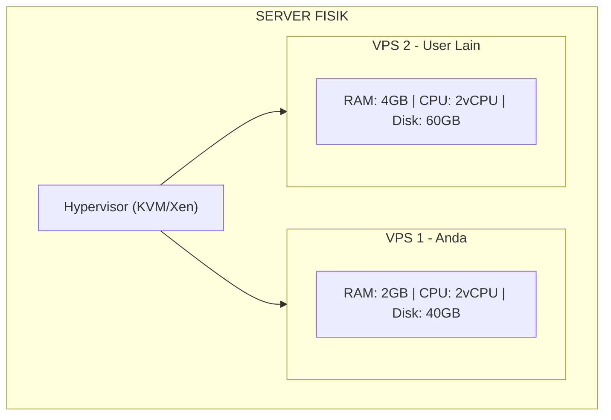
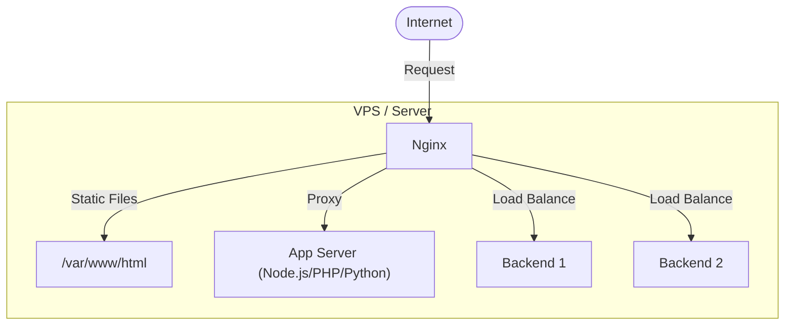

# 🚀 Pertemuan 12: Setup VPS & Konfigurasi Nginx

## Daftar Isi
1. [Pengantar VPS dan Web Server](#1-pengantar-vps-dan-web-server)
2. [Hands-On: Setup VPS dengan Sumopod & EasyPanel](#2-hands-on-setup-vps-dengan-sumopod--easypanel)
3. [Pengantar Nginx sebagai Web Server & Reverse Proxy](#3-pengantar-nginx-sebagai-web-server--reverse-proxy)
4. [Hands-On: Konfigurasi Nginx Lengkap](#4-hands-on-konfigurasi-nginx-lengkap)
5. [Proteksi Bot & Scanning dengan Nginx](#5-proteksi-bot--scanning-dengan-nginx)
6. [Setup SSL Certificate dengan Certbot](#6-setup-ssl-certificate-dengan-certbot)
7. [Monitoring dan Logging](#7-monitoring-dan-logging)
8. [Latihan Mandiri](#8-latihan-mandiri)

---

## 1. Pengantar VPS dan Web Server

### 1.1 Apa itu VPS?

**VPS (Virtual Private Server)** adalah server virtual yang berjalan di atas hardware fisik bersama, namun memberikan sumber daya yang terdedikasi (RAM, CPU, Storage). VPS lebih terjangkau dari dedicated server namun lebih powerful dari shared hosting.



### 1.2 Mengapa Nginx?

Nginx (dibaca "engine-x") adalah web server dan reverse proxy yang sangat efisien. Keunggulannya:
- Handling concurrent connection yang tinggi (event-driven, non-blocking)
- Konsumsi memori rendah dibanding Apache
- Bisa berfungsi sebagai Load Balancer, SSL Terminator, dan WAF dasar
- Konfigurasi deklaratif yang mudah dibaca

---

## 2. Hands-On: Setup VPS dengan Sumopod & EasyPanel

### 2.1 Daftar Akun Sumopod

1. Buka link referral: `https://sumopod.com`
2. Isi form registrasi (Nama, Email, Password)
3. Verifikasi email yang dikirim Sumopod

.png)

### 2.2 Top Up Saldo

Masuk ke dashboard → **Billing → Add Credit**

Top up minimal **Rp 60.000** untuk paket VPS paling dasar.

.png)

### 2.3 Buat VPS Baru

1. Klik **Create VPS** di dashboard
2. Pilih provider **Tencent Cloud**, lokasi **Singapore**
3. Pilih paket: **2 vCPU, 2 GB RAM, 40 GB SSD** (Rp 60.000/bulan)
4. Konfigurasi:
   - OS: **Ubuntu 24.04 LTS**
   - Region: **Singapore**
   - Hostname: `netsec-lab`

.png)

.png)

5. Klik **Create VPS → I Agree, Create VPS**
6. Tunggu 5–15 menit hingga status berubah **Pending → Active**

.png)

### 2.4 Login SSH ke VPS

Setelah VPS aktif, catat **IP Address**, **Username** (`ubuntu`), dan **Password**.

**Cara termudah — SSH via Browser:**
1. Buka `https://ssheasy.com`
2. Masukkan Host/IP, Username, Password
3. Klik **Connect**

.png)

### 2.5 Install Docker & EasyPanel

```bash
# 1. Masuk sebagai root
sudo su

# 2. Install Docker
apt-get update && apt-get install -y docker.io docker-compose

# 3. Install EasyPanel
curl -sSL https://get.easypanel.io | sh
```

.png)

.png)

Tunggu hingga muncul pesan: `Easypanel installed successfully`

### 2.6 Akses Dashboard EasyPanel

Buka browser → `http://IP_VPS_ANDA:3000`

Buat akun administrator pertama kali dengan Email dan Password.

.png)

.png)

---

## 3. Pengantar Nginx sebagai Web Server & Reverse Proxy

### 3.1 Mode Operasi Nginx



### 3.2 Arsitektur Reverse Proxy dengan Nginx

| Komponen | Fungsi |
| :------- | :----- |
| **Nginx (Port 80/443)** | Entry point publik, SSL termination |
| **App Server (Port 3000/8000)** | Backend yang tidak terekspos langsung |
| **WAF Rules** | Filter request berbahaya di level Nginx |

---

## 4. Hands-On: Konfigurasi Nginx Lengkap

### 4.1 Persiapan di Server / VM

```bash
# Update sistem dan install Nginx
sudo apt update
sudo apt install nginx -y

# Cek status
sudo systemctl status nginx
sudo systemctl enable nginx
sudo systemctl start nginx

# Backup konfigurasi default
sudo cp /etc/nginx/nginx.conf /etc/nginx/nginx.conf.backup
```

### 4.2 Buat Struktur Direktori

```bash
sudo mkdir -p /var/www/netsec-lab/html
sudo mkdir -p /var/www/netsec-lab/logs
sudo chown -R $USER:$USER /var/www/netsec-lab/html
sudo chmod -R 755 /var/www/netsec-lab
```

### 4.3 Buat File Konfigurasi

```bash
sudo nano /etc/nginx/sites-available/netsec-lab
```

Isi dengan konfigurasi berikut:

```nginx
# Rate limiting zone
limit_req_zone $binary_remote_addr zone=api_limit:10m rate=10r/s;
limit_req_zone $binary_remote_addr zone=login_limit:10m rate=5r/m;
limit_conn_zone $binary_remote_addr zone=conn_limit:10m;

# Block User-Agent berbahaya (Tools hacking & scanning)
map $http_user_agent $blocked_ua {
    default 0;
    ~*(curl|wget|nmap|nikto|burpsuite|sqlmap|python-requests|Go-http-client|Scrapy|Hydra|masscan|openvas|nessus) 1;
}

server {
    listen 80;
    server_name localhost;

    root /var/www/netsec-lab/html;
    index index.html;

    access_log /var/www/netsec-lab/logs/access.log;
    error_log  /var/www/netsec-lab/logs/error.log;

    # Security Headers
    add_header X-Frame-Options      "SAMEORIGIN" always;
    add_header X-Content-Type-Options "nosniff" always;
    add_header X-XSS-Protection     "1; mode=block" always;
    server_tokens off;

    # Block User-Agent berbahaya
    if ($blocked_ua) { return 403; }
    if ($http_user_agent = "") { return 403; }

    # Rate limiting global
    limit_req  zone=api_limit burst=20 nodelay;
    limit_conn conn_limit 10;

    # Block HTTP methods berbahaya
    if ($request_method !~ ^(GET|HEAD|POST|PUT|DELETE|PATCH)$) {
        return 405;
    }

    # Proteksi SQL Injection via query string
    set $blocked 0;
    if ($query_string ~* "(union.*select|select.*from|drop.*table|insert.*into)") {
        set $blocked 1;
    }
    if ($query_string ~* "(\.\./|\.\.\\\\)") {
        set $blocked 1;
    }
    if ($blocked = 1) { return 403; }

    location / {
        try_files $uri $uri/ =404;
    }

    # Rate limit khusus login
    location /login {
        limit_req zone=login_limit burst=2 nodelay;
        limit_req_status 429;
    }

    # Block file tersembunyi dan konfigurasi
    location ~ /\. { deny all; return 403; }
    location ~* \.(ini|conf|log|bak|sql|sh|env)$ { deny all; return 403; }

    # Static file caching
    location ~* \.(jpg|jpeg|png|gif|ico|css|js|svg|woff|woff2)$ {
        expires 30d;
        add_header Cache-Control "public, immutable";
        access_log off;
    }

    error_page 403 /403.html;
    error_page 404 /404.html;
}
```

### 4.4 Aktifkan Konfigurasi

```bash
# Buat symbolic link
sudo ln -s /etc/nginx/sites-available/netsec-lab /etc/nginx/sites-enabled/

# Hapus default site (opsional)
sudo rm -f /etc/nginx/sites-enabled/default

# Test konfigurasi
sudo nginx -t

# Jika output: "test is successful"
sudo systemctl reload nginx
```

---

## 5. Proteksi Bot & Scanning dengan Nginx

### 5.1 Testing Konfigurasi Proteksi

```bash
# Test dengan curl (seharusnya 403 karena User-Agent curl)
curl -A "curl/7.68.0" http://localhost/

# Test dengan wget (seharusnya 403)
curl -A "wget/1.20" http://localhost/

# Test dengan browser normal User-Agent (seharusnya 200)
curl -A "Mozilla/5.0 (Windows NT 10.0; Win64; x64) AppleWebKit/537.36" http://localhost/
```

### 5.2 Test SQL Injection Blocking

```bash
# Seharusnya diblokir (403)
curl "http://localhost/?id=1+UNION+SELECT+1,2,3"
curl "http://localhost/?q=SELECT+*+FROM+users"

# Request normal (seharusnya 200)
curl "http://localhost/?page=1&category=security"
```

### 5.3 Test Rate Limiting

```bash
# Loop request cepat (akan kena rate limit setelah ~20 request)
for i in $(seq 1 30); do
  curl -o /dev/null -s -w "%{http_code}\n" \
    -A "Mozilla/5.0 (normal browser)" http://localhost/
done
```

---

## 6. Setup SSL Certificate dengan Certbot

### 6.1 Install Certbot (Untuk Domain Asli)

```bash
# Ubuntu/Debian
sudo apt install certbot python3-certbot-nginx -y

# Dapatkan SSL certificate (ganti dengan domain Anda)
sudo certbot --nginx -d yourdomain.com -d www.yourdomain.com

# Setup auto-renewal
sudo certbot renew --dry-run
```

### 6.2 Self-Signed Certificate (Untuk Lab Lokal)

```bash
# Buat direktori SSL
sudo mkdir -p /etc/nginx/ssl

# Generate self-signed certificate
sudo openssl req -x509 -nodes -days 365 -newkey rsa:2048 \
  -keyout /etc/nginx/ssl/lab.key \
  -out /etc/nginx/ssl/lab.crt \
  -subj "/C=ID/ST=Jakarta/L=Jakarta/O=NetSec Lab/CN=localhost"

# Tambahkan ke konfigurasi Nginx
# Ganti listen 80; dengan:
# listen 443 ssl;
# ssl_certificate /etc/nginx/ssl/lab.crt;
# ssl_certificate_key /etc/nginx/ssl/lab.key;
```

---

## 7. Monitoring dan Logging

### 7.1 Monitor Log Real-Time

```bash
# Monitor access log
sudo tail -f /var/www/netsec-lab/logs/access.log

# Filter request yang diblokir (403)
sudo tail -f /var/www/netsec-lab/logs/access.log | grep " 403 "

# Filter bot yang terdeteksi
sudo tail -f /var/www/netsec-lab/logs/access.log | grep -E "(curl|wget|nmap|nikto)"
```

### 7.2 Script Monitoring Bot

```bash
sudo nano /usr/local/bin/monitor-bot.sh
```

```bash
#!/bin/bash
LOG="/var/www/netsec-lab/logs/access.log"
echo "=== Bot Detection Report ==="
echo ""
echo "Total request diblokir (403):"
grep " 403 " $LOG | wc -l

echo ""
echo "Top 10 IP yang diblokir:"
grep " 403 " $LOG | awk '{print $1}' | sort | uniq -c | sort -rn | head -10

echo ""
echo "User-Agent scanning tools terdeteksi:"
grep -E "(curl|wget|nmap|nikto|sqlmap)" $LOG | awk -F'"' '{print $6}' | sort | uniq -c | sort -rn
```

```bash
sudo chmod +x /usr/local/bin/monitor-bot.sh
sudo /usr/local/bin/monitor-bot.sh
```

### 7.3 Setup Fail2ban (Opsional)

```bash
sudo apt install fail2ban -y

# Buat filter
sudo nano /etc/fail2ban/filter.d/nginx-bot.conf
```

```ini
[Definition]
failregex = ^<HOST> -.*(curl|wget|nmap|nikto|sqlmap).*$
            ^<HOST> -.*"(GET|POST).*(union|select|drop).*" (403|400).*$
ignoreregex =
```

```bash
sudo nano /etc/fail2ban/jail.local
```

```ini
[nginx-bot]
enabled  = true
port     = http,https
filter   = nginx-bot
logpath  = /var/www/netsec-lab/logs/access.log
maxretry = 3
bantime  = 3600
findtime = 600
```

```bash
sudo systemctl restart fail2ban
sudo fail2ban-client status nginx-bot
```

---

## 8. Latihan Mandiri

### Latihan 1: Deploy Aplikasi ke VPS
Menggunakan VPS yang sudah dibuat dan EasyPanel:
1. Push Docker image aplikasi sederhana (PHP/Node.js) ke Docker Hub
2. Deploy image tersebut via EasyPanel
3. Konfigurasi Nginx sebagai reverse proxy untuk aplikasi tersebut
4. Verifikasi aplikasi bisa diakses via domain/IP VPS

### Latihan 2: Hardening Nginx
Tambahkan fitur berikut ke konfigurasi Nginx:
1. Blokir akses ke `/admin` dari IP selain lokal
2. Custom error page 403 dengan pesan "Access Denied by Security Policy"
3. Tambahkan header `Strict-Transport-Security` (HSTS)

### Latihan 3: Analisis Log
Jalankan Nikto terhadap Nginx yang sudah dikonfigurasi, lalu:
1. Amati log access_log dalam real-time
2. Identifikasi request mana yang berhasil diblokir
3. Buat ringkasan: berapa persen request Nikto yang berhasil diblokir?
