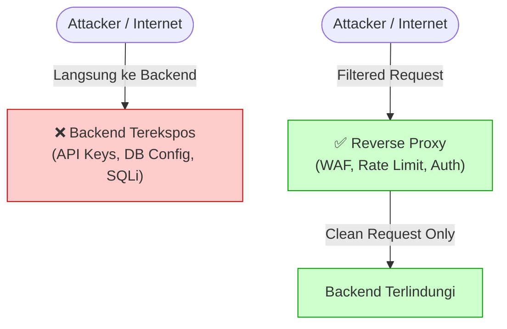
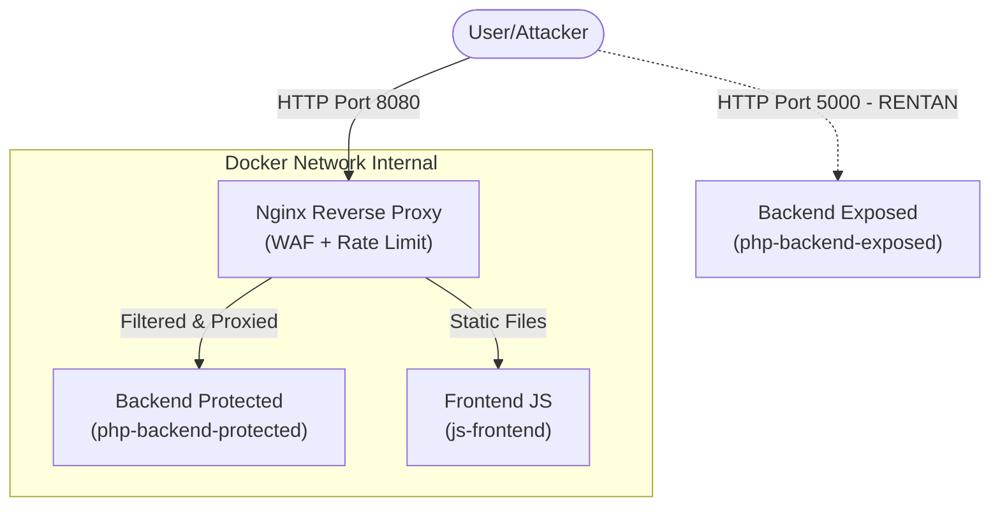
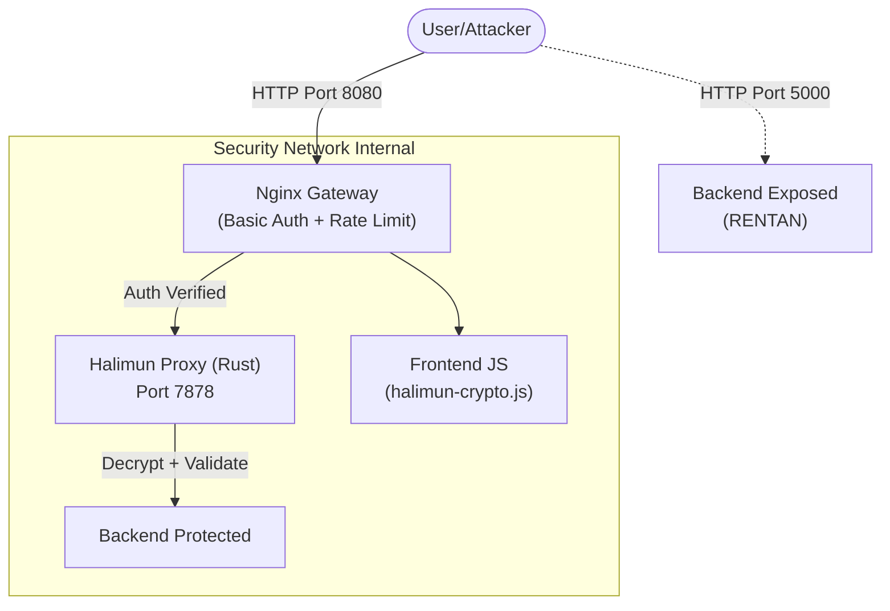

# 🛡️ Pertemuan 13: Hands-On Reverse Proxy — NginxProxy & HalimunProxy

## Daftar Isi
1. [Konsep Reverse Proxy sebagai Lapisan Keamanan](#1-konsep-reverse-proxy-sebagai-lapisan-keamanan)
2. [Lab A: NginxProxy — WAF Dasar](#2-lab-a-nginxproxy--waf-dasar)
3. [Hands-On NginxProxy: Menjalankan Lab](#3-hands-on-nginxproxy-menjalankan-lab)
4. [Hands-On NginxProxy: Skenario Serangan & Defense](#4-hands-on-nginxproxy-skenario-serangan--defense)
5. [Lab B: HalimunProxy — Encrypted Reverse Proxy](#5-lab-b-halimunproxy--encrypted-reverse-proxy)
6. [Hands-On HalimunProxy: Menjalankan Lab](#6-hands-on-halimunproxy-menjalankan-lab)
7. [Hands-On HalimunProxy: Skenario Serangan & Defense](#7-hands-on-halimunproxy-skenario-serangan--defense)
8. [Perbandingan: Tanpa Proxy vs NginxProxy vs HalimunProxy](#8-perbandingan-tanpa-proxy-vs-nginxproxy-vs-halimunproxy)
9. [Latihan Mandiri](#9-latihan-mandiri)

---

## 1. Konsep Reverse Proxy sebagai Lapisan Keamanan

### 1.1 Forward Proxy vs Reverse Proxy

| Aspek | Forward Proxy | Reverse Proxy |
| :---- | :------------ | :------------ |
| **Melindungi** | Client | Server |
| **Posisi** | Di depan client | Di depan server |
| **Contoh** | VPN, Tor | Nginx, HAProxy, Cloudflare |
| **Fungsi** | Menyembunyikan identitas user | Menyembunyikan & melindungi backend |

### 1.2 Mengapa Reverse Proxy Penting?



---

## 2. Lab A: NginxProxy — WAF Dasar

### 2.1 Arsitektur Lab



### 2.2 Komponen Lab

| Komponen | Port | Keterangan |
| :------- | :--- | :--------- |
| **Dashboard Lab** | `http://localhost:8080` | Entry point via Nginx Proxy |
| **Protected API** | `http://localhost:8080/api/` | API dilindungi WAF |
| **Direct Backend** | `http://localhost:5000` | Backend langsung (**RENTAN**) |

### 2.3 Fitur Keamanan yang Diuji

- **Path Restriction**: Blokir akses ke `/config`, `/sensitive`, `.git`
- **WAF Rules**: Blokir SQL Injection (`union`, `select`, `drop`) dan XSS (`<script>`)
- **Rate Limiting**: Maksimal 10 req/detik (burst 20)
- **Security Headers**: Sembunyikan `X-Powered-By` dan `Server`

---

## 3. Hands-On NginxProxy: Menjalankan Lab

### Langkah 1: Masuk ke Folder NginxProxy

```bash
cd HandsOnServerProxy/NginxProxy
```

### Langkah 2: Jalankan Docker Compose

```bash
docker-compose up -d --build
```

**Tunggu output:**
```
[+] Running 4/4
 ✔ Container php-backend-exposed   Started
 ✔ Container php-backend-protected Started
 ✔ Container js-frontend           Started
 ✔ Container nginx-gateway         Started
```

### Langkah 3: Verifikasi Container Berjalan

```bash
docker ps
```

Output yang diharapkan:
```
CONTAINER ID   IMAGE         STATUS         NAMES
xxxx           nginx:alpine  Up X seconds   nginx-gateway
xxxx           php-lab       Up X seconds   php-backend-exposed
xxxx           php-lab       Up X seconds   php-backend-protected
xxxx           frontend-img  Up X seconds   js-frontend
```

### Langkah 4: Buka Dashboard Lab

Buka browser → `http://localhost:8080`

Anda akan melihat dashboard simulasi dengan dua panel:
- **Direct Backend** (kiri) — koneksi langsung ke backend rentan
- **Nginx Proxy** (kanan) — koneksi via proxy terproteksi

---

## 4. Hands-On NginxProxy: Skenario Serangan & Defense

### 4.1 Test Proteksi via Browser Dashboard

Di `http://localhost:8080`, klik setiap tombol dan amati perbedaan respons:

| Aksi | Direct Backend (Port 5000) | Via Nginx Proxy (Port 8080) |
| :--- | :------------------------- | :--------------------------- |
| Get Users | ✅ Data terekspos | ✅ Data bisa diakses |
| Get Config | ✅ **API Keys & DB password BOCOR!** | ❌ **403 Forbidden** |
| Get Sensitive File | ✅ File sensitif terekspos | ❌ **403 Forbidden** |
| SQL Injection | ✅ Injeksi berhasil | ❌ **400 Bad Request** |

### 4.2 Test via Terminal (curl)

```bash
# Test 1: Proteksi Path — Config
echo "=== Direct Backend (akan tampil data sensitif) ==="
curl http://localhost:5000/api.php/config

echo "=== Via Nginx Proxy (diblokir) ==="
curl -I http://localhost:8080/api/config
# Expected: HTTP/1.1 403 Forbidden
```

```bash
# Test 2: SQL Injection Protection
echo "=== Direct (data terekspos) ==="
curl "http://localhost:5000/api.php/users?id=1 OR 1=1"

echo "=== Via Proxy (diblokir) ==="
curl -I "http://localhost:8080/api/users?id=1+UNION+SELECT+1,2,3"
# Expected: HTTP/1.1 400 Bad Request
```

```bash
# Test 3: Header Comparison
echo "=== Direct Backend Headers ==="
curl -I http://localhost:5000/api.php/users

echo "=== Via Nginx Proxy Headers ==="
curl -I http://localhost:8080/api/users
# Perhatikan: header Server dan X-Powered-By disembunyikan
```

### 4.3 Simulasi Penetrasi dengan Kali Linux

**Langkah 1: Jalankan Container Kali di Jaringan Lab**

```bash
# Pastikan berada di folder NginxProxy
docker run --rm -it --network nginxproxy_public-net kalilinux/kali-rolling /bin/bash
```

**Langkah 2: Install Tools**

```bash
apt update && apt install -y nmap sqlmap curl
```

**Langkah 3: Nmap Scanning**

```bash
nmap -F nginx-gateway
nmap -F php-backend-exposed
```

**Langkah 4: SQLmap Attack**

```bash
# Backend langsung — BERHASIL (rentan)
sqlmap -u "http://php-backend-exposed/api.php/users?id=1" --batch --banner

# Via Nginx Proxy — GAGAL (terblokir)
sqlmap -u "http://nginx-gateway/api/users?id=1" --batch --banner
```

**Observasi:**
- Direct: `sqlmap` mendeteksi parameter rentan dan berhasil scanning
- Via Nginx: `400 Bad Request` atau `403 Forbidden` — sqlmap tidak bisa melanjutkan

### 4.4 Monitor Log Real-Time

```bash
# Buka terminal baru di host
docker logs -f nginx-gateway
```

---

## 5. Lab B: HalimunProxy — Encrypted Reverse Proxy

### 5.1 Perbedaan dengan NginxProxy

HalimunProxy adalah reverse proxy berbasis **Rust** yang menambahkan lapisan keamanan yang jauh lebih ketat:

| Fitur | NginxProxy | HalimunProxy |
|-------|------------|--------------|
| **Enkripsi Payload** | ❌ Tidak ada | ✅ AES-256-CBC wajib |
| **Replay Protection** | ❌ Tidak ada | ✅ Nonce + Timestamp |
| **URL Camouflage** | ❌ URL asli terlihat | ✅ URL di-obfuscate |
| **SSRF Protection** | ❌ Tidak ada | ✅ Blokir IP internal |
| **Basic Auth** | ❌ Tidak ada | ✅ Username/Password |

### 5.2 Arsitektur Lab HalimunProxy



### 5.3 Komponen Lab

| Komponen | URL/Port | Keterangan |
| :------- | :------- | :--------- |
| **Dashboard Lab** | `http://localhost:8080` | Via Nginx (Basic Auth: `admin/admin`) |
| **Halimun Proxy** | `http://localhost:8080/proxy/` | Jalur terenkripsi |
| **Direct Backend** | `http://localhost:5000` | Akses langsung (**RENTAN**) |
| **Admin Dashboard** | `http://localhost:8080/dashboard/` | Statistik traffic real-time |

---

## 6. Hands-On HalimunProxy: Menjalankan Lab

### Langkah 1: Masuk ke Folder HalimunProxy

```bash
cd HandsOnServerProxy/HalimunProxy
```

### Langkah 2: Build dan Jalankan

```bash
docker-compose up -d --build
```

> **Catatan:** HalimunProxy menggunakan Rust. Proses build pertama kali memakan waktu **1–3 menit**.

Tunggu sampai semua container running:
```
✔ Container php-backend-exposed   Started
✔ Container php-backend-protected Started
✔ Container js-frontend           Started
✔ Container halimun-proxy         Started
✔ Container nginx-gateway         Started
```

### Langkah 3: Akses Lab

```bash
docker ps
```

Buka browser → `http://localhost:8080`

Masukkan Basic Auth:
- **Username**: `admin`
- **Password**: `admin`

---

## 7. Hands-On HalimunProxy: Skenario Serangan & Defense

### 7.1 Test Basic Auth

```bash
# Tanpa auth — DITOLAK
curl -I http://localhost:8080/proxy/1/users
# Expected: 401 Unauthorized

# Dengan auth yang benar
curl -u admin:admin -I http://localhost:8080/proxy/1/users
```

### 7.2 Test Enkripsi Wajib

```bash
# Request plaintext ke jalur proxy — DITOLAK
curl -u admin:admin -X POST http://localhost:8080/proxy/1/users \
  -H "Content-Type: application/json" \
  -d '{"test": "plain text, bukan enkripsi"}'
# Expected: 400/403 — payload tidak terenkripsi
```

### 7.3 Test Replay Protection

1. Buka `http://localhost:8080`
2. Di dashboard, klik tombol request ke proxy
3. **Klik tombol yang sama segera setelahnya**
4. Observasi: Request pertama → `200 OK`, Request kedua → ditolak karena Nonce sudah digunakan

### 7.4 Perbandingan Header Information Leakage

```bash
# Backend langsung — info server terlihat
echo "=== Direct Backend ==="
curl -I http://localhost:5000/api.php/users

# Via HalimunProxy — info tersembunyi
echo "=== Via HalimunProxy ==="
curl -u admin:admin -I http://localhost:8080/
```

### 7.5 Simulasi Penetrasi Kali Linux vs HalimunProxy

**Langkah 1: Jalankan Kali di Jaringan Lab**

```bash
docker run --rm -it --network halimunproxy_public-net kalilinux/kali-rolling /bin/bash
```

**Langkah 2: Install Tools**

```bash
apt update && apt install -y nmap sqlmap curl
```

**Langkah 3: Nmap Scan**

```bash
nmap -F nginx-gateway
nmap -F php-backend-exposed
```

Port 7878 (Halimun internal) **tidak terlihat** dari jaringan publik.

**Langkah 4: SQLmap vs Direct Backend — BERHASIL**

```bash
sqlmap -u "http://php-backend-exposed/api.php/users?id=1" --batch --banner
```

**Langkah 5: SQLmap vs HalimunProxy — GAGAL TOTAL**

```bash
sqlmap -u "http://nginx-gateway/proxy/1/ANY" \
  --headers="Authorization: Basic YWRtaW46YWRtaW4=" \
  --method=POST --data="x=test" --batch
```

**Analisis:** SQLmap gagal karena Halimun-Proxy menolak semua payload yang tidak terenkripsi AES-256-CBC. Scanner otomatis tidak bisa fuzzing karena setiap request dianggap "sampah" oleh proxy.

### 7.6 Monitor Log Real-Time

```bash
docker logs -f halimun-proxy
```

---

## 8. Perbandingan: Tanpa Proxy vs NginxProxy vs HalimunProxy

| Vektor Serangan | Tanpa Proxy | NginxProxy | HalimunProxy |
| :-------------- | :---------- | :--------- | :----------- |
| **Akses File Config** | ✅ BERHASIL | ❌ 403 Blocked | ❌ 403 Blocked |
| **SQL Injection (sqlmap)** | ✅ BERHASIL | ❌ 400 Blocked | ❌ GAGAL TOTAL |
| **Brute Force API** | ✅ Bebas | ⚠️ Rate limited | ❌ Rate limit + Auth |
| **Header Info Leak** | ✅ Terlihat | ⚠️ Sebagian | ❌ Tersembunyi penuh |
| **Replay Attack** | ✅ BERHASIL | ✅ BERHASIL | ❌ Ditolak (Nonce) |
| **SSRF Attack** | ✅ BERHASIL | ⚠️ Parsial | ❌ Blokir IP internal |
| **Nikto Scan** | ✅ Banyak temuan | ⚠️ Sebagian diblokir | ❌ Semua diblokir |

---

## 9. Latihan Mandiri

### Tantangan 1: Rate Limit Analysis (NginxProxy)
Bombardir `http://localhost:8080/api/users` dengan loop request cepat. Amati kapan muncul `429 Too Many Requests` dan berapa lama sampai bisa normal lagi.

```bash
for i in $(seq 1 50); do
  curl -o /dev/null -s -w "Request $i: %{http_code}\n" \
    -A "Mozilla/5.0 (normal)" http://localhost:8080/api/users
done
```

### Tantangan 2: WAF Custom Rule
1. Buka `HandsOnServerProxy/NginxProxy/nginx-proxy/default.conf`
2. Tambahkan rule baru untuk memblokir keyword `xss` di query string
3. Restart: `docker-compose restart nginx-proxy`
4. Uji apakah `http://localhost:8080/api/users?q=xss_test` diblokir

### Tantangan 3: Replay Attack (HalimunProxy)
1. Buka Browser DevTools (F12) → tab Network
2. Akses `http://localhost:8080` dan kirim request via dashboard
3. Capture parameter `x` dari request di Network tab
4. Kirim ulang payload yang sama via Postman atau curl
5. Jelaskan mengapa request kedua ditolak

### Tantangan 4: Header Analysis Lengkap
Buat tabel perbandingan header response dari:
- `http://localhost:5000/api.php/users` (direct)
- `http://localhost:8080/api/users` (NginxProxy)
- `http://localhost:8080/` dengan auth (HalimunProxy)

Informasi apa yang berhasil disembunyikan di setiap layer?
