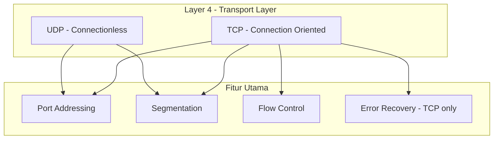
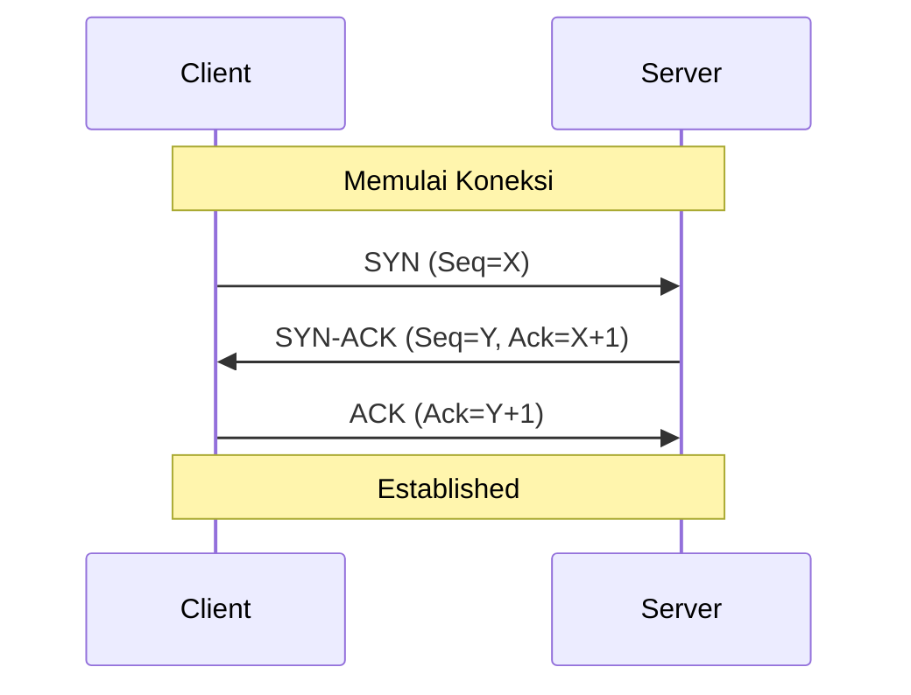
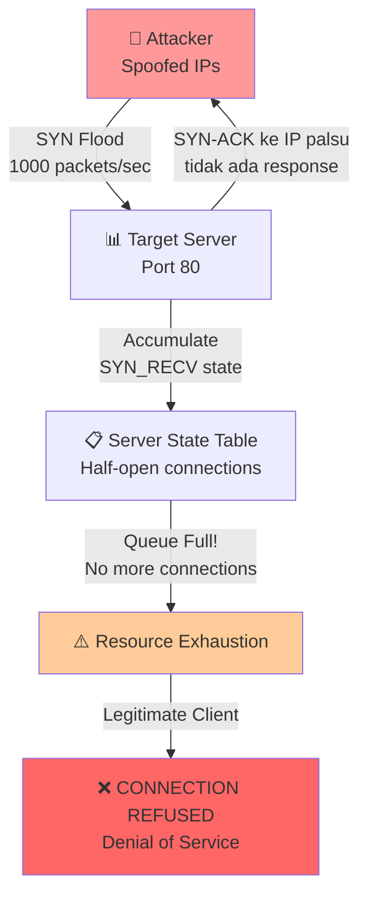
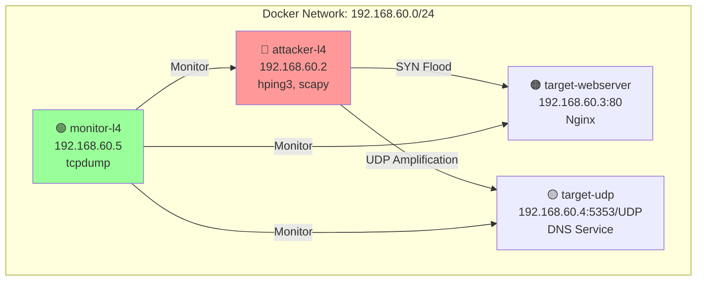
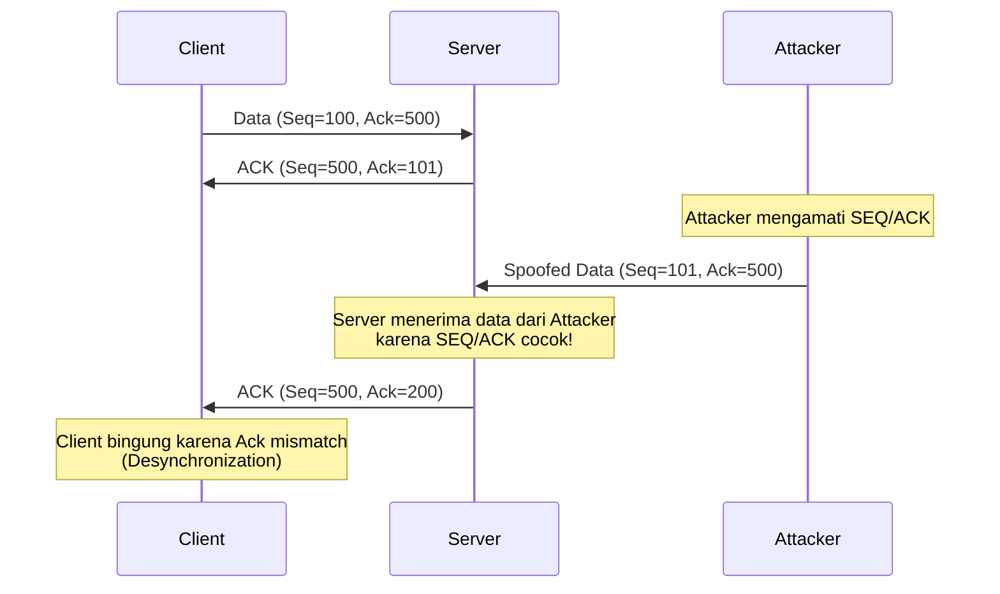
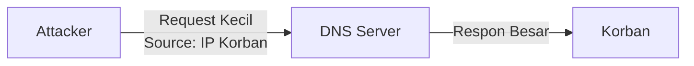

# 🔄 Pertemuan 6: L4 Security - TCP/UDP Attacks

## Daftar Isi
1. [Pengantar Layer 4 Security](#1-pengantar-layer-4-security)
2. [TCP Three-Way Handshake Deep Dive](#2-tcp-three-way-handshake-deep-dive)
3. [TCP Flags & Kerentanannya](#3-tcp-flags--kerentanannya)
4. [Docker Hands-On: Setup Lab L4 Attacks](#4-docker-hands-on-setup-lab-l4-attacks)
5. [Hands-On: SYN Flood Attack dengan hping3](#5-hands-on-syn-flood-attack-dengan-hping3)
6. [Hands-On: TCP Session Hijacking Concepts](#6-hands-on-tcp-session-hijacking-concepts)
7. [UDP Security & Amplification](#7-udp-security--amplification)
8. [Deteksi dan Pencegahan](#8-deteksi-dan-pencegahan)
9. [Latihan Mandiri](#9-latihan-mandiri)

---

## 1. Pengantar Layer 4 Security

### Model OSI Layer 4 (Transport Layer)



### Fungsi Utama Layer 4
1. **Port Addressing** - Memastikan data sampai ke aplikasi yang benar (misal: 80 untuk HTTP).
2. **Segmentation** - Membagi data besar menjadi segmen-segmen kecil.
3. **Session Management** - Membangun dan memutuskan koneksi (TCP).

---

## 2. TCP Three-Way Handshake Deep Dive

TCP memastikan pengiriman data yang handal melalui proses jabat tangan (handshake).



### Kelemahan Handshake
Proses ini memakan resource di sisi server (state table). Server harus menyimpan informasi tentang koneksi yang "setengah terbuka" (half-open connection).

### SYN Flood Attack Flow



---

## 3. TCP Flags & Kerentanannya

| Flag    | Deskripsi                      | Potensi Abuse           |
| ------- | ------------------------------ | ----------------------- |
| **SYN** | Sinkronisasi nomor urut        | SYN Flood (DoS)         |
| **ACK** | Konfirmasi penerimaan paket    | Blind ACK Injection     |
| **FIN** | Mengakhiri koneksi normal      | FIN Scan (Stealth)      |
| **RST** | Memutuskan koneksi paksa       | Connection Reset Attack |
| **PSH** | Push data langsung ke aplikasi | Buffer pressure         |
| **URG** | Data mendesak                  | Segment evasion         |

---

## 4. Docker Hands-On: Setup Lab L4 Attacks

### 4.1 Docker Lab Untuk Transport Layer

Docker containers memungkinkan simulasi **multiple hosts, services, dan network conditions** tanpa perlu setup kompleks:

**Keuntungan Docker untuk L4 Lab:**
- 🚀 **Fast Setup** - Mulai lab dalam 30 detik
- 🔧 **Service Isolation** - Web server, DNS, UDP services dalam container terpisah
- 📊 **Real Network Tools** - tcpdump, tshark, netstat bekerja normal di container
- 🎯 **Easy Targeting** - Attack container IP addresses 192.168.60.x
- 💾 **Persistent Logs** - Simpan PCAP dan logs untuk analisis

### 4.2 Quick Start

**Persiapkan Lab:**

```bash
mkdir -p l4-lab && cd l4-lab
wget https://raw.githubusercontent.com/yourrepo/Labs/docker-compose-p6.yml
# atau copy dari Labs/docker-compose-p6.yml

# Start lab
docker-compose -f docker-compose-p6.yml up -d
docker-compose ps
```

**Verify Lab Running:**

```bash
# Check network
docker network ls | grep l4-lab

# Get container IPs
docker-compose exec attacker-l4 ip addr show eth0

# Test connectivity
docker-compose exec attacker-l4 ping 192.168.60.3
```

### 4.3 Lab Topology



### 4.4 Pre-configured Services

**Web Server (target-webserver)** - Listening on port 80
```bash
# Check server status
docker-compose exec target-webserver curl http://localhost

# Monitor connections
docker-compose exec target-webserver netstat -atn
```

**DNS Service (target-udp)** - Listening on port 5353/UDP
```bash
# Test DNS query
docker-compose exec attacker-l4 nslookup google.com 192.168.60.4:5353
```

### 4.5 Cleanup

```bash
docker-compose down
docker-compose down -v  # Remove volumes juga
```

---

## 5. Hands-On: SYN Flood Attack dengan hping3

### 5.1 Apa itu SYN Flood?
Penyerang mengirimkan ribuan paket SYN tanpa pernah membalas SYN-ACK dari server. Akibatnya, antrean koneksi server penuh dan tidak bisa menerima client baru.

### 5.2 Setup Lab dengan Docker
Containers sudah siap dari docker-compose. Pastikan container berjalan:

```bash
# Di folder l4-lab
docker-compose exec attacker-l4 bash
hping3 --version
```

### 5.3 Menjalankan Serangan

**Terminal 1 - Monitor Target:**

```bash
# Di target-webserver
docker-compose exec target-webserver bash
netstat -atn | grep SYN_RECV  # Lihat half-open connections
```

**Terminal 2 - Monitor dengan tcpdump:**

```bash
docker-compose exec monitor-l4 bash
tcpdump -i eth0 'tcp[tcpflags] & tcp-syn != 0' -c 100
```

**Terminal 3 - Jalankan Attack:**

```bash
# Di attacker-l4
docker-compose exec attacker-l4 bash

# Kirim SYN flood ke target
hping3 -S --flood --rand-source -p 80 192.168.60.3
```

Parameter:
- `-S`: Set SYN flag
- `--flood`: Kirim sepat mungkin (ribuan/detik)
- `--rand-source`: IP spoofing untuk sulit diblokir
- `-p 80`: Target port web server

### 5.4 Observasi Serangan

**Di Monitor (tcpdump):**
```
19:20:15.452341 IP attacker.12345 > target.80: Flags [S], seq 0, win 512
19:20:15.452389 IP attacker.23456 > target.80: Flags [S], seq 0, win 512
19:20:15.452421 IP attacker.34567 > target.80: Flags [S], seq 0, win 512
... (ribuan dalam waktu singkat)
```

**Di Target (netstat):**
```
SYN_RECV connections: 100+ (semua ke port 80)
```

### 5.5 Mencegah/Mitigasi SYN Flood

**Aktifkan SYN Cookies di Target:**

```bash
docker-compose exec target-webserver bash

# Aktifkan SYN cookies
sysctl -w net.ipv4.tcp_syncookies=1

# Cek status
sysctl net.ipv4.tcp_syncookies  # should return 1
```

**Rate Limiting dengan iptables:**

```bash
# Limit SYN packets dari satu IP ke 10 per detik
iptables -A INPUT -p tcp --syn -m limit --limit 10/s --limit-burst 20 -j ACCEPT
iptables -A INPUT -p tcp --syn -j DROP
```

---

## 6. Hands-On: TCP Session Hijacking Concepts

### 5.1 Mekanisme Serangan
Session Hijacking terjadi ketika penyerang mengambil alih sesi aktif antara client dan server dengan memprediksi **Next Sequence Number**.



### 5.2 Teknik Prediksi SEQ
Dahulu Sequence Number bersifat linear, namun OS modern menggunakan **ISN (Initial Sequence Number)** yang acak. Namun, jika penyerang berada dalam jalur jaringan (MITM), mereka tetap bisa melihat nomor tersebut.

---

## 6. UDP Security & Amplification

UDP tidak memiliki handshake (connectionless), sehingga sangat mudah dipalsukan (spoofing).

### UDP Amplification Attack
Memanfaatkan service UDP (DNS, NTP, SNMP) untuk mengirim respon besar ke korban dari request kecil yang dipalsukan.



---

## 7. Deteksi dan Pencegahan

### 7.1 TCP SYN Cookies
Teknik untuk menangani SYN Flood tanpa menghabiskan memory state table.

```bash
# Cek apakah SYN cookies aktif di Linux
sysctl net.ipv4.tcp_syncookies

# Aktifkan jika belum
sysctl -w net.ipv4.tcp_syncookies=1
```

### 7.2 Rate Limiting
Membatasi jumlah koneksi per IP menggunakan `iptables`.

```bash
# Batasi 10 koneksi baru per detik dari satu IP
iptables -A INPUT -p tcp --syn -m limit --limit 1/s --limit-burst 10 -j ACCEPT
```

---

## 8. Latihan Mandiri

### Latihan 1: Analisis Paket SYN Flood
1. Jalankan `tcpdump` di target.
2. Jalankan `hping3` dari attacker selama 10 detik.
3. Simpan file `.pcap` dan buka di Wireshark.
4. Hitung berapa banyak paket SYN yang masuk tanpa ACK.

### Latihan 2: Penutupan Port
Gunakan `nmap` untuk menscan port yang terbuka di target dan tutup port yang tidak digunakan untuk mengurangi attack surface Layer 4.
