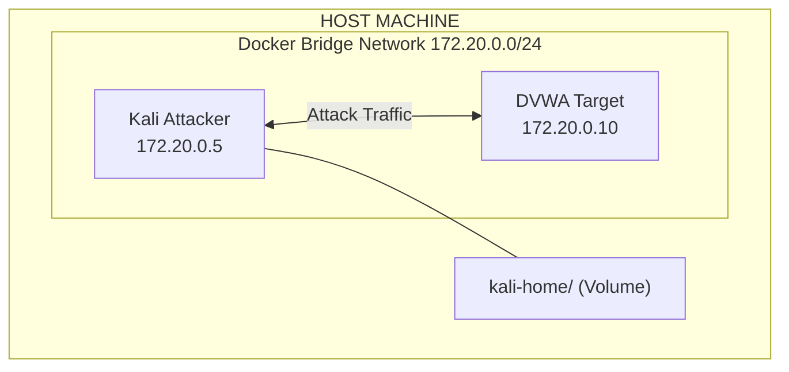

# 🛡️ Network Security Lab: Docker & Kali Linux

Selamat datang di repositori pusat mata kuliah **Network Security**. Repositori ini dirancang sebagai panduan praktis (hands-on) untuk memahami vektor serangan jaringan dan metodologi pertahanan menggunakan lingkungan terkontainerisasi yang aman.

---

## 📋 Daftar Kurikulum (16 Pertemuan)

### Modul Infrastruktur & Network Attacks — Pertemuan 1–7

| Sesi | Topik | Detail Aktivitas & Tools |
| :---: | :---- | :----------------------- |
| **00** | **Docker & Kali Setup** | Instalasi Docker Desktop, perintah dasar `docker run/ps/exec`, volumes, bridge network, Docker Compose. |
| **01** | **Pengantar Network Security & Setup Lab** | CIA Triad, `docker-compose` multi-container, Kali + DVWA, eksperimen persistensi volume. |
| **02** | **Cryptography 101** | Praktik `openssl` (AES/RSA), hashing `md5sum`/`sha256sum`, analisis sertifikat SSL/TLS. |
| **03** | **L2 Security: ARP Spoofing** | `arpspoof` (dsniff), IP Forwarding, DNS Spoofing via `iptables` NAT. |
| **04** | **Wireless Security** | Simulasi WPA2 handshake, `aircrack-ng` suite, serangan deauth dengan `aireplay-ng`. |
| **05** | **L3 Security: IP/ICMP** | Scapy, Smurf Attack, DHCP Starvation (`yersinia`), ICMP Redirect MITM. |
| **06** | **L4 Security: TCP/UDP** | Three-way handshake, SYN Flood (`hping3`), TCP Session Hijacking, UDP Amplification. |
| **07** | **DNS Security** | DNS Cache Poisoning, DNS Exfiltration via TXT record, DNSSEC, DoH. |

### 🏫 UTS — Pertemuan 8

| Sesi | Topik | Keterangan |
| :---: | :---- | :--------- |
| **08** | **UTS** | Ujian Tengah Semester — mencakup materi Pertemuan 1–7. Soal teori CIA Triad, ARP, Wireless, L3/L4, DNS + soal praktik Docker Compose & `openssl`. |

### Modul Application Security & Defense — Pertemuan 9–15

| Sesi | Topik | Detail Aktivitas & Tools |
| :---: | :---- | :----------------------- |
| **09** | **SQL Injection** | Manual union-based injection & automated scanning (`sqlmap`) pada DVWA. Mitigasi: prepared statements. |
| **10** | **XSS & CSRF** | Pencurian cookie via Stored XSS, form auto-submit CSRF, mitigasi: CSP, HttpOnly, SameSite, Anti-CSRF Token. |
| **11** | **CVE & CVSS** | CVE ID lifecycle, CVSS v4.0 metric groups (Base/Threat/Environmental), NVD, studi kasus Log4Shell. Hands-on: NVD API, `nikto`, CVSS Calculator. |
| **12** | **Setup VPS & Nginx** | Provisioning VPS (Sumopod + EasyPanel), konfigurasi Nginx sebagai WAF + Reverse Proxy, Rate Limiting, SSL (Certbot), Fail2ban. |
| **13** | **Hands-On Reverse Proxy** | Lab NginxProxy (WAF dasar) vs HalimunProxy (AES-256-CBC encrypted proxy, Replay Protection, SSRF Guard). Penetrasi dengan `sqlmap` + Kali. |
| **14** | **Firewalling dengan iptables** | Implementasi rules (Drop, Reject, Accept), Rate Limiting koneksi, deteksi port scanning. |
| **15** | **IDS dengan Snort** | Arsitektur Snort, custom rules untuk deteksi Nmap scan dan SSH Brute Force, analisis alert. |

### 🏆 UAS — Pertemuan 16

| Sesi | Topik | Keterangan |
| :---: | :---- | :--------- |
| **16** | **UAS** | Ujian Akhir Semester — komprehensif Pertemuan 1–15. Full pentest: Deployment VPS + EasyPanel, Reconnaissance, Vulnerability Assessment, Security Monitoring, OWASP Mapping, Remediation Plan. |

---

## 🧪 Hands-On Labs (Docker)

Dua lab siap pakai yang bisa langsung dijalankan.

### Lab 1: NginxProxy — WAF Dasar

Simulasi backend terbuka (port 5000) vs backend terlindungi di belakang Nginx (port 8080) dengan proteksi SQL Injection, path restriction, dan rate limiting.

```bash
cd HandsOnServerProxy/NginxProxy
docker-compose up -d --build
```

| URL | Keterangan |
| :-- | :--------- |
| `http://localhost:8080` | Dashboard lab (via Nginx Proxy) |
| `http://localhost:8080/api/users` | API dilindungi WAF |
| `http://localhost:5000` | Backend langsung — **RENTAN** |

### Lab 2: HalimunProxy — Encrypted Reverse Proxy

Proxy berbasis Rust dengan enkripsi AES-256-CBC end-to-end, replay protection (Nonce + Timestamp), SSRF guard, dan Basic Auth di level Nginx.

```bash
cd HandsOnServerProxy/HalimunProxy
docker-compose up -d --build
```

| URL | Keterangan |
| :-- | :--------- |
| `http://localhost:8080` | Dashboard lab — login: **admin / admin** |
| `http://localhost:8080/proxy/` | Jalur terenkripsi |
| `http://localhost:8080/dashboard/` | Statistik traffic real-time |
| `http://localhost:5000` | Backend langsung — **RENTAN** |

---

## 🏗️ Arsitektur Lab Docker



### Contoh `docker-compose.yml` Dasar

```yaml
version: '3.8'

services:
  kali-attacker:
    image: kalilinux/kali-rolling
    container_name: kali-attacker
    tty: true
    stdin_open: true
    privileged: true
    volumes:
      - ./kali-home:/root
    networks:
      lab_network:
        ipv4_address: 172.20.0.5

  victim-web:
    image: vulnerables/web-dvwa
    container_name: web-target
    networks:
      lab_network:
        ipv4_address: 172.20.0.10

networks:
  lab_network:
    driver: bridge
    ipam:
      config:
        - subnet: 172.20.0.0/24
```

---

## 🎓 Tugas & Proyek

### Tugas E-Learning: Black-Box Pentest ke Target Publik

Simulasi pengujian penetrasi terhadap aplikasi web yang di-deploy di Vercel secara black-box.

- **Target**: `https://hackable-pentest.vercel.app/`
- **Tools**: WhatWeb, curl, dig, dirb, nikto, nmap, sqlmap (di dalam Kali container)
- **Fase**: Reconnaissance → Scanning → Exploitation → Analisis Kode → Laporan
- **Template Pengumpulan**: [Google Docs](https://docs.google.com/document/d/1wN5IxH3eungsvaZVP67xxS8DcsW7USBlHjlRb5jWMLw/edit?usp=sharing)

> Lihat [`E-Learning.md`](./E-Learning.md) untuk panduan lengkap.

---

### Proyek UAS: Web Penetration Testing & Security Monitoring

Full pentest terhadap dua aplikasi yang di-deploy ke VPS sendiri menggunakan EasyPanel.

**Cakupan Penilaian:**

| Bagian | Bobot | Keterangan |
| :----- | :---: | :--------- |
| Deployment & Reconnaissance | 25% | EasyPanel, Nmap, WhatWeb, curl |
| Analisis Perbedaan Sistem | 25% | Komparasi Project 1 vs Project 2 |
| Vulnerability Assessment | 20% | SQLi, IDOR, Directory Listing, Error Handling |
| Security Monitoring & Log Analysis | 15% | Log EasyPanel, korelasi aktivitas |
| Risk Assessment & OWASP Mapping | 10% | Pemetaan ke OWASP Top 10 2021 |
| Remediation Plan | 5% | Rekomendasi teknis per temuan |

> Lihat [`Study-Case-Project-Exploit.md`](./Study-Case-Project-Exploit.md) untuk soal UAS lengkap.

---

## 🗂️ Struktur Repositori

```
Network-Security-Course-Bank/
├── README.md                          ← Anda di sini
├── index.html                         ← Portal web kursus
├── Pertemuan0.md  – Pertemuan16.md    ← Modul kuliah
├── E-Learning.md                      ← Tugas black-box pentest
├── Study-Case-Project-Exploit.md      ← Soal UAS lengkap
│
├── HandsOnServerProxy/
│   ├── NginxProxy/                    ← Lab WAF Dasar (docker-compose)
│   └── HalimunProxy/                  ← Lab Encrypted Proxy (docker-compose)
│
├── CVEandCVSS/                        ← Referensi modul CVE & CVSS
├── Nginx/                             ← Referensi konfigurasi Nginx lengkap
└── SetupVPS/                          ← Panduan setup VPS + EasyPanel
```

---

## 📚 Sumber Belajar & Referensi

| Sumber | Link |
| :----- | :--- |
| OWASP Top 10 | [owasp.org](https://owasp.org/www-project-top-ten/) |
| PortSwigger Web Security Academy | [portswigger.net](https://portswigger.net/web-security) |
| National Vulnerability Database (NVD) | [nvd.nist.gov](https://nvd.nist.gov) |
| CVSS v4.0 Calculator | [first.org/cvss](https://www.first.org/cvss/calculator/4.0) |
| MITRE ATT&CK | [attack.mitre.org](https://attack.mitre.org/) |
| GTFOBins | [gtfobins.github.io](https://gtfobins.github.io/) |
| Kali Linux Docs | [kali.org/docs](https://www.kali.org/docs/) |
| Docker Documentation | [docs.docker.com](https://docs.docker.com/) |
